

# Queen Anne Airbnb

### Same home. A listing guests book.

<table>
<tr><td width="28%" valign="top"><b>Client</b></td><td valign="top">Ben Frost · <a href="https://cascadiastr.com">Cascadia STR</a></td></tr>
<tr><td width="28%" valign="top"><b>Property</b></td><td valign="top">7 bedrooms, 12 beds</td></tr>
<tr><td width="28%" valign="top"><b>Area</b></td><td valign="top">Queen Anne, Seattle</td></tr>
<tr><td width="28%" valign="top"><b>Shot</b></td><td valign="top">One fall afternoon, November 2026</td></tr>
<tr><td width="28%" valign="top"><b>Before</b></td><td valign="top">Listed with phone photos</td></tr>
</table>

---

## ✨ Before & after

Left: the **old Airbnb listing** photo. Right: the same space, photographed by Pacific Haus Media.

### The jetted tub with a balcony view

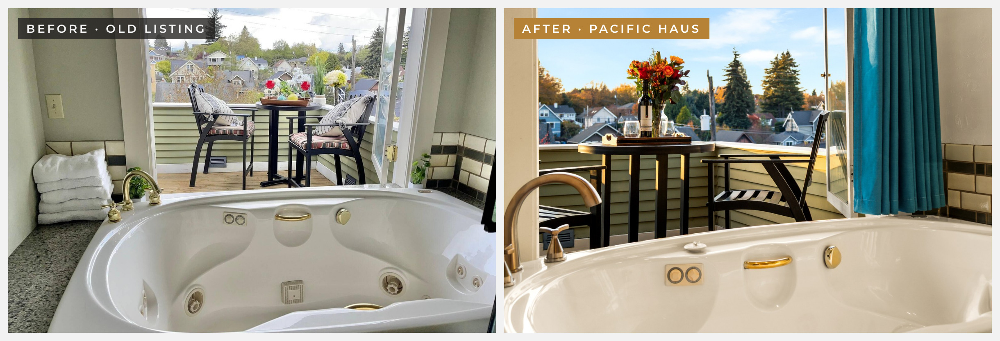

**Before:** towels stacked on the ledge and a pale, flat view out the door.

**What we did:** cleared the ledge, styled the balcony table with fall flowers, and blended exposures so the tub and the skyline both hold detail.

### Living room: show the room, not a corner

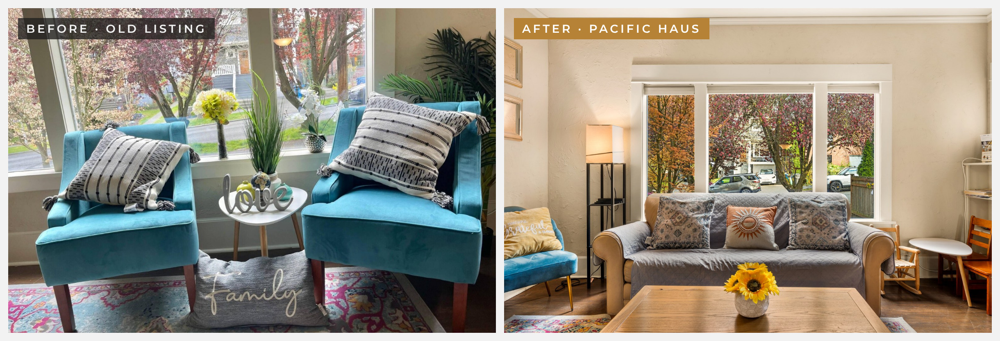

**Before:** a tight shot of two chairs and decor signs. Guests couldn't tell how big the room is.

**What we did:** a level wide angle from the corner, with the sofa, coffee table and front window in one frame.

### Primary bath: clutter out, details in

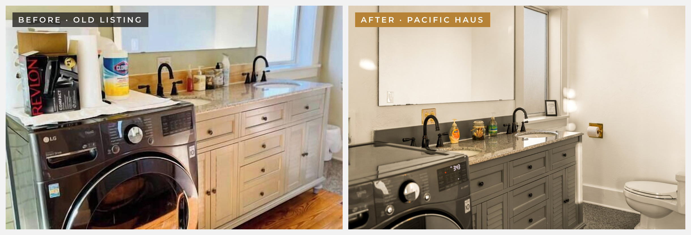

**Before:** a hair-tool box, wipes and paper towels on the washer, close and off-angle.

**What we did:** cleared every surface, added a few styled touches, and pulled back so the double sinks lead the frame.

### Pergola deck guests can picture using

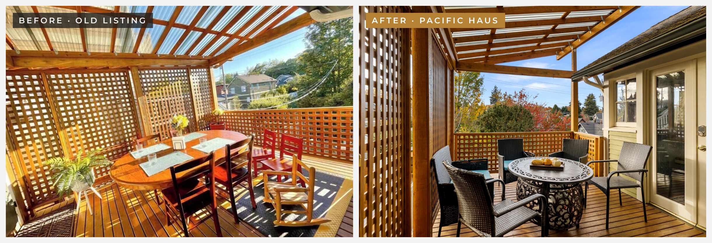

**Before:** hard noon light, deep shadow stripes across the table and a washed-out sky.

**What we did:** shot in softer light, kept the lattice lines straight, and opened the frame to the trees and rooftops.

---

## 📸 The gallery

<table>
<tr><td width="50%" align="center" valign="top">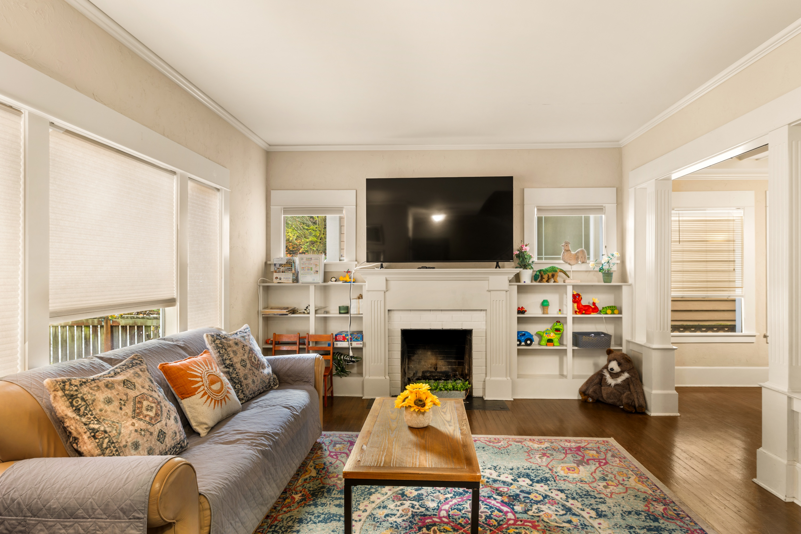</td><td width="50%" align="center" valign="top">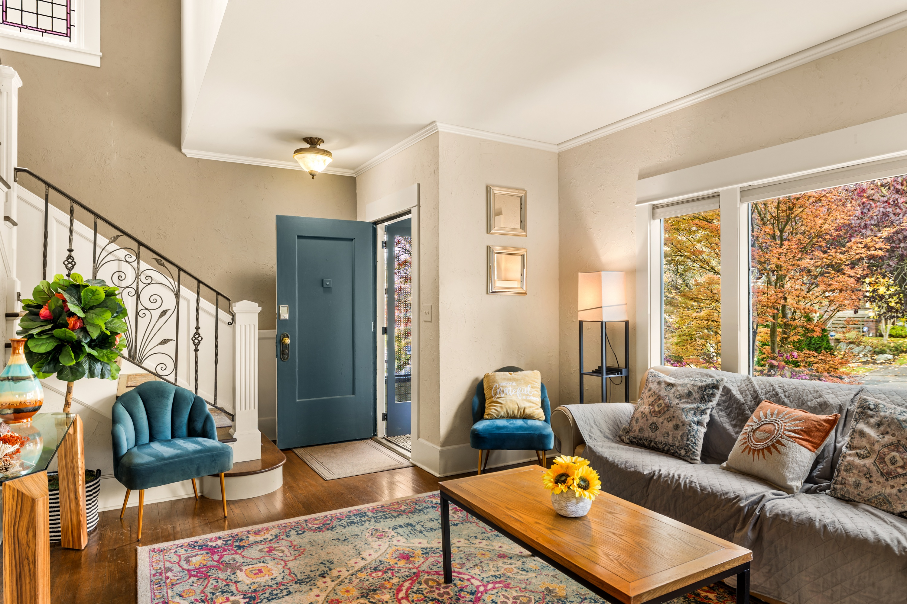</td></tr>
<tr><td width="50%" align="center" valign="top">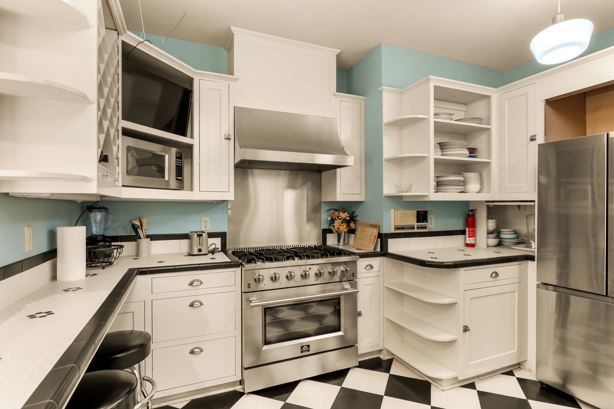</td><td width="50%" align="center" valign="top">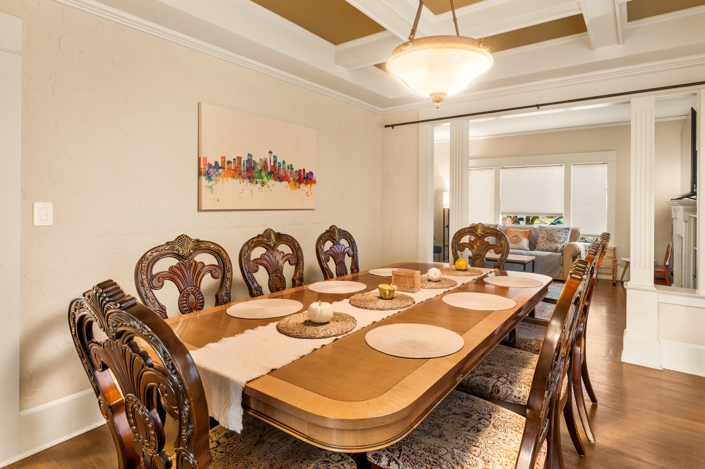</td></tr>
<tr><td width="50%" align="center" valign="top">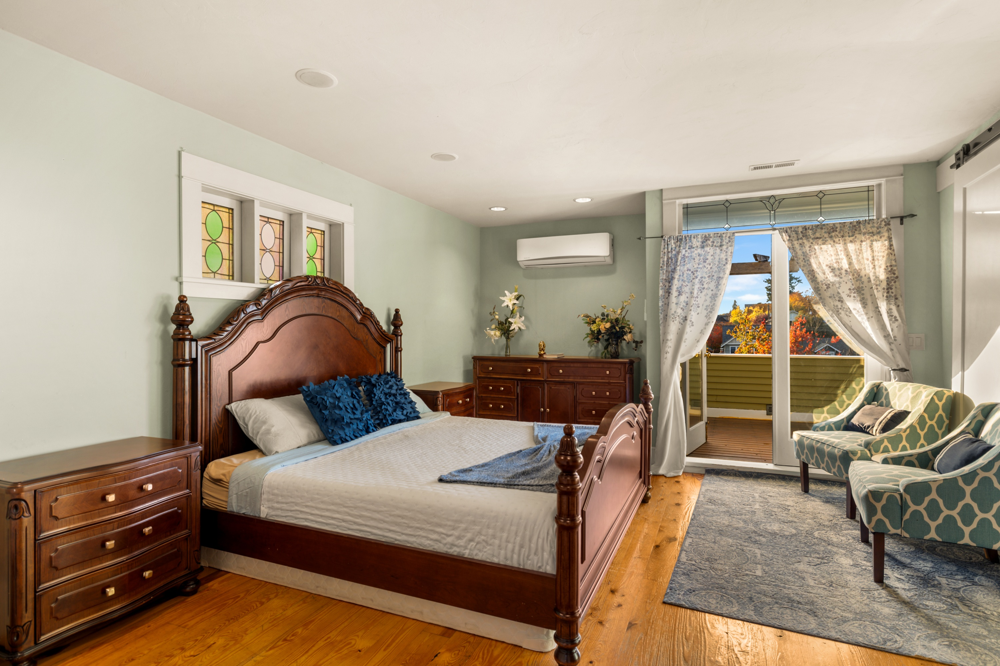</td><td width="50%" align="center" valign="top">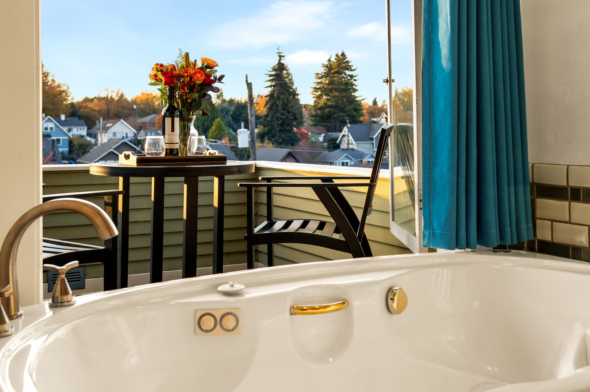</td></tr>
<tr><td width="50%" align="center" valign="top">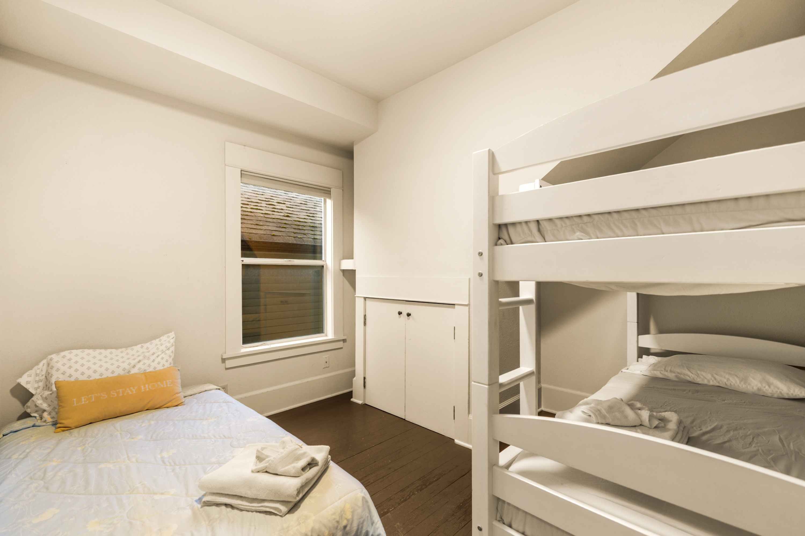</td><td width="50%" align="center" valign="top">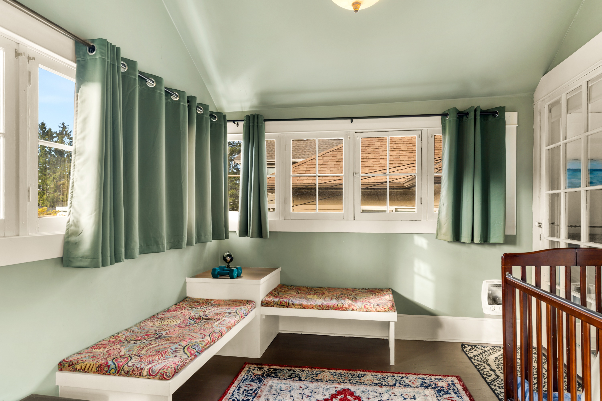</td></tr>
<tr><td width="50%" align="center" valign="top">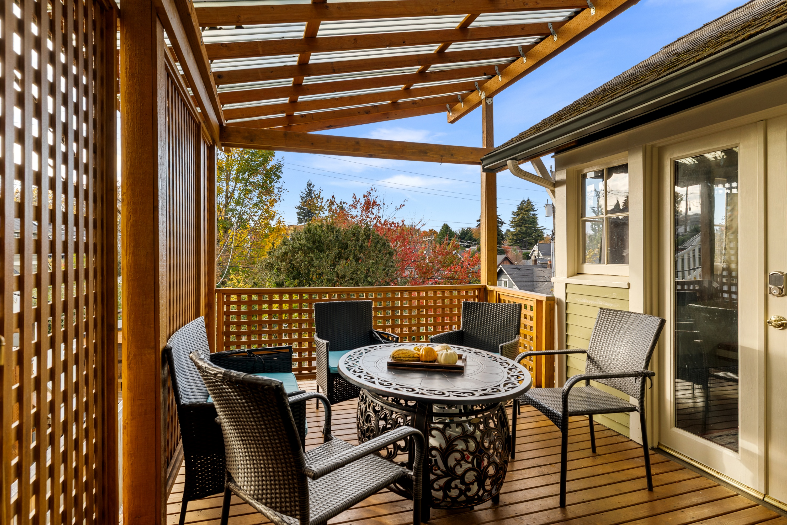</td><td width="50%" align="center" valign="top">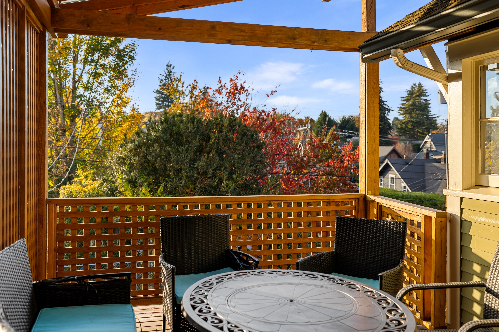</td></tr>
</table>

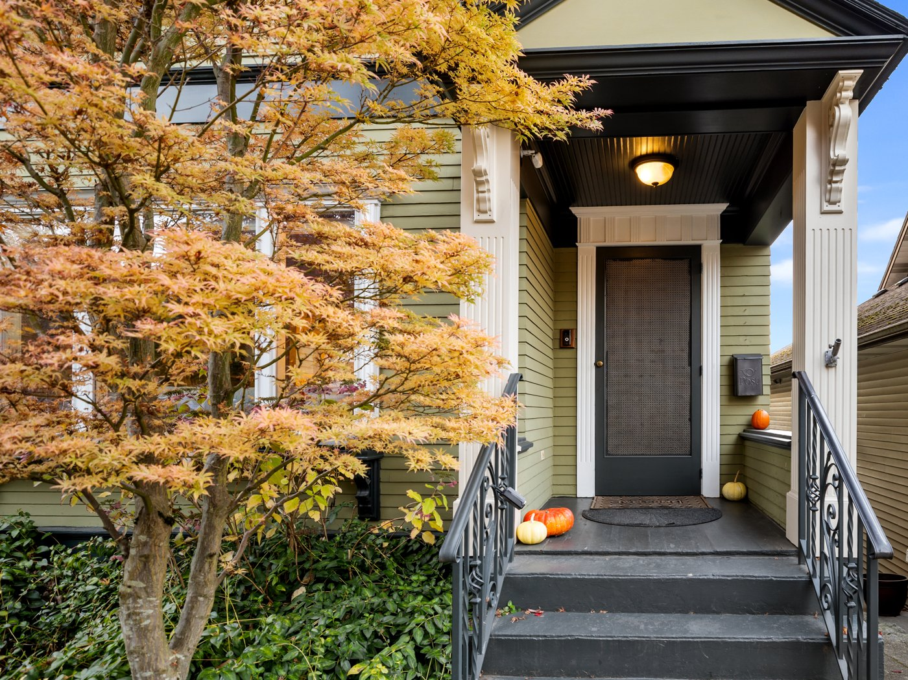

---

## 💬 From the client

> These turned out fantastic! Sunday was a bit of a juggling act with the turnover, cleaning crew, and getting everything ready for the shoot. But we caught some beautiful fall sunshine, and you absolutely nailed it. Really enjoyed working with you on this one. Looking forward to more!
>
> **Ben Frost** · Cascadia STR

---

**Hosting in Seattle?** Book a shoot at [pacifichausmedia.com](https://pacifichausmedia.com)

"Before" images are the property's previous listing photos. "After" images © Pacific Haus Media.

[← All showcases](../README.md)

