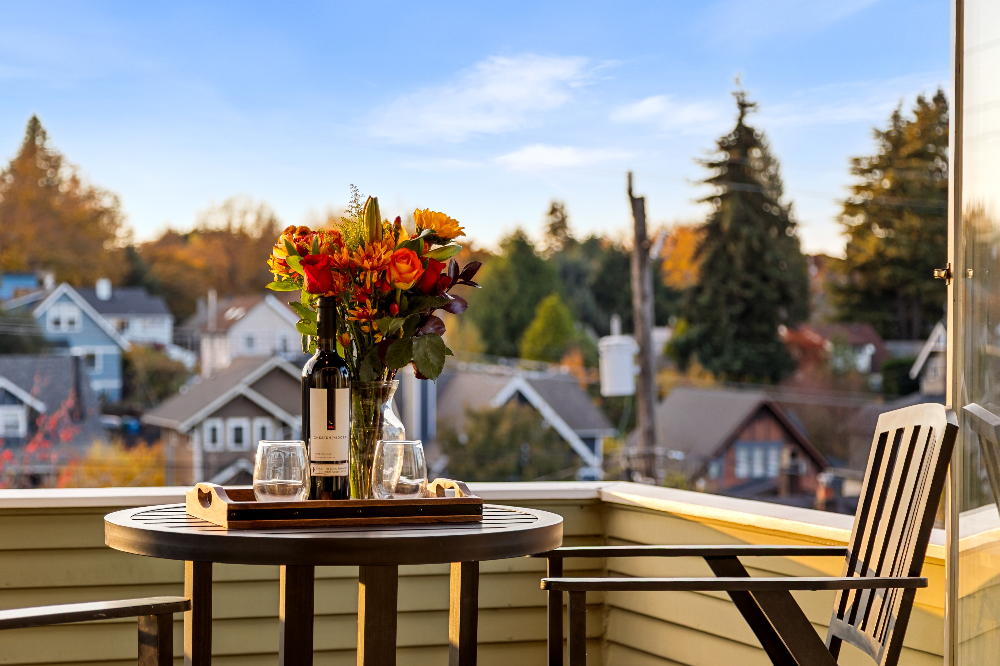
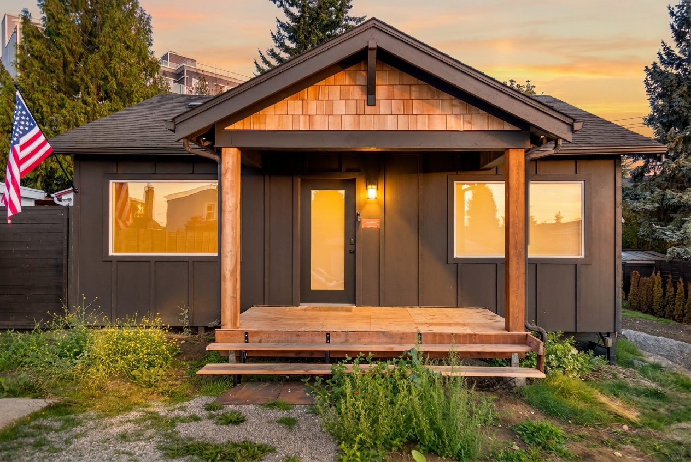
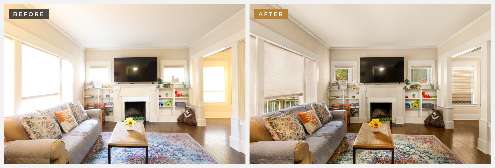

<picture>
  <source media="(prefers-color-scheme: dark)" srcset="assets/brand/logo-dark.png">
  
</picture>

### Real Estate Photography & Visual Marketing

Seattle · the Eastside · Snohomish County

[Website](https://pacifichausmedia.com) · [Instagram](https://www.instagram.com/pacifichausmedia) · [Book a shoot](https://www.pacifichausmedia.com/book)

---

## 🏡 Showcases

<table>
<tr><td width="50%" align="center" valign="top"></td><td width="50%" align="center" valign="top"></td></tr>
<tr><td width="50%" align="center" valign="top"><b><a href="2026-11-queen-anne-airbnb/">Queen Anne Airbnb</a></b> 7-bedroom short-term rental · Nov 2026 ✨ Before & afters inside</td><td width="50%" align="center" valign="top"><b><a href="2026-09-junction-retreat-airbnb/">The Junction Retreat</a></b> West Seattle Airbnb · Sep 2026 Photos, drone & walkthrough video</td></tr>
</table>

---

## ✨ Before & after

Straight from the camera on the left, finished on the right. [See all five →](2026-11-queen-anne-airbnb/#-before--after)

---

## 📋 All shoots

| Date | Shoot | Type | Area |
|---|---|---|---|
| Nov 2026 | [Queen Anne Airbnb](2026-11-queen-anne-airbnb/) | Airbnb · 7 bedrooms | Queen Anne, Seattle |
| Sep 2026 | [The Junction Retreat](2026-09-junction-retreat-airbnb/) | Airbnb | West Seattle |

---

**Want photos like these?** Book at [pacifichausmedia.com](https://pacifichausmedia.com)

Each shoot has its own folder named `year-month-place-type`, with a story page and a `photos` folder.

